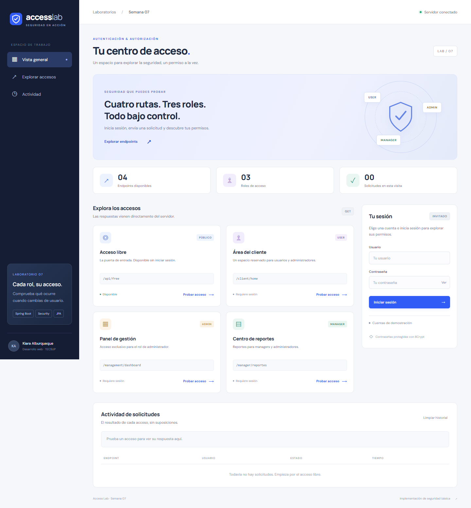

# Access Lab · Laboratorio 07

Aplicación completa de **Spring Security**, con frontend integrado, autenticación HTTP Basic, contraseñas BCrypt y permisos por rol. Desarrolla la actividad de `GLAB-S07-RCOELLO-2026-01-1.docx`.



## Arranque completo con MySQL (Windows)

Desde **Git Bash**, en la carpeta del proyecto:

```bash
cmd.exe //c scripts\\start-lab.cmd
```

Desde PowerShell:

```powershell
.\scripts\start-lab.cmd
```

El script prepara **MySQL Community 8.4.11 oficial**, crea `securitydb` y arranca el frontend y backend en **http://localhost:8080/**. MySQL escucha solo en `127.0.0.1:3307`, sin registrar servicios de Windows ni modificar otras instalaciones. La primera vez descarga aproximadamente 268 MB y necesita Internet y el runtime Visual C++ requerido por MySQL. Necesitas JDK 17 o superior.

Los datos y las claves aleatorias del usuario de base de datos se guardan únicamente en `.cache/mysql/`, ignorado por Git. La aplicación usa `security_lab`, con permisos limitados a las bases del laboratorio. Las cuentas `user`, `admin` y `manager` conservan las claves de demostración indicadas más abajo.

Los procesos siguen funcionando aunque cierres la terminal. Para detenerlos sin borrar los datos:

```bash
cmd.exe //c scripts\\stop-lab.cmd
```

Ejecutar nuevamente `start-lab.cmd` reconoce la instancia que ya arrancó. Si el puerto 8080 pertenece a otra instancia, indica que debes cerrarla. Los registros están en `.cache/mysql/app.log` y `.cache/mysql/server.log`.

## Modo alternativo sin MySQL

Necesitas **JDK 17 o superior**, con `JAVA_HOME` apuntando al JDK. Maven se descarga automáticamente mediante el wrapper; la primera ejecución necesita Internet. No necesitas Node para ejecutar la aplicación.

En PowerShell, desde la carpeta del proyecto:

```powershell
.\mvnw.cmd spring-boot:run "-Dspring-boot.run.profiles=demo"
```

También puedes abrir `scripts\start-demo.cmd` en Windows. En Linux/macOS:

```bash
chmod +x mvnw
./mvnw spring-boot:run -Dspring-boot.run.profiles=demo
```

Abre **http://localhost:8080**. El perfil `demo` usa H2 en memoria y pierde los datos al detener el servidor. Frontend y backend se sirven desde la misma aplicación.

## Ejecución con MySQL, como solicita la guía

1. Inicia MySQL y ejecuta [sql/01-create-database.sql](sql/01-create-database.sql).
2. Configura la conexión. El usuario por defecto es `root`, sin contraseña; ajusta los valores a tu instalación.
3. Arranca sin el perfil `demo`:

```powershell
$env:DB_URL = 'jdbc:mysql://localhost:3306/securitydb'
$env:DB_USERNAME = 'root'
$env:DB_PASSWORD = 'TU_CLAVE_MYSQL'
.\mvnw.cmd spring-boot:run
```

Hibernate crea las tablas `users`, `roles` y `user_roles`. Si ya tenías las tablas `user`/`role` de la guía, esta implementación usa sus propias tablas y crea las cuentas de demostración en ellas.

Si tienes Docker, puedes iniciar MySQL y la aplicación juntos:

```bash
docker compose up --build
```

Luego abre http://localhost:8080. El laboratorio completo se verificó con MySQL portable en Windows. Docker es una alternativa opcional preparada; no se ejecutó localmente.

## Cuentas y permisos

Estas son cuentas públicas de **demostración local**, no credenciales personales:

| Usuario | Contraseña nueva | Rol |
| --- | --- | --- |
| `user` | `UsuarioS07!2026` | `ROLE_USER` |
| `admin` | `AdminS07!2026` | `ROLE_ADMIN` |
| `manager` | `ManagerS07!2026` | `ROLE_MANAGER` |

Puedes cambiar las claves con `LAB_USER_PASSWORD`, `LAB_ADMIN_PASSWORD` y `LAB_MANAGER_PASSWORD` antes de iniciar el servidor. El cargador sincroniza las cuentas del laboratorio al arrancar y guarda hashes BCrypt. Al cambiar las variables también debes actualizar las claves en Postman o escribirlas manualmente en el frontend.

| Ruta | Invitado | USER | ADMIN | MANAGER |
| --- | --- | --- | --- | --- |
| `/api/free` | 200 | 200 | 200 | 200 |
| `/client/home` | 401 | 200 | 200 | 403 |
| `/management/dashboard` | 401 | 403 | 200 | 403 |
| `/manager/reportes` | 401 | 403 | 200 | 200 |

La guía no define la jerarquía de `MANAGER`: se decidió darle acceso a reportes junto con `ADMIN`, conservando el acceso de cliente para `USER`/`ADMIN`. Las rutas anteriores se eliminaron; con credenciales válidas devuelven 404. Sin credenciales, el filtro puede responder primero 401.

`GET /api/me` identifica al usuario autenticado y sus roles para el frontend. No devuelve la contraseña.

## Frontend funcional

- Inicio de sesión comprobado contra la base de datos y cierre de sesión.
- Cuatro tarjetas que consultan endpoints reales; las rutas sin permiso también se pueden probar para observar 401/403.
- Estado de conexión, respuesta del servidor e historial de las últimas doce solicitudes.
- Diseño adaptable a escritorio y móvil, navegación por teclado y mensajes de error.
- Credenciales solo en memoria: no se guardan en cookies, `localStorage` ni `sessionStorage`; recargar cierra la sesión del frontend.

HTTP Basic y CSRF desactivado siguen el enfoque didáctico de la guía. El frontend envía la cabecera explícitamente y no usa sesiones. Para publicar una aplicación real, requiere HTTPS y revisar autenticación, CSRF, usuarios semilla y gestión de secretos; subir el código a GitHub no despliega el servidor Java.

## Pruebas

Backend, sin necesidad de MySQL:

```powershell
.\mvnw.cmd verify
```

**32 pruebas verificadas con H2 y repetidas con MySQL**, incluyendo la matriz de permisos, claves antiguas rechazadas, BCrypt, carga idempotente, perfil autenticado y recursos del frontend. Para ejecutarlas con MySQL portable en una base de pruebas separada (`securitydb_test`):

```powershell
powershell.exe -NoProfile -ExecutionPolicy Bypass -File scripts/test-mysql.ps1
```

Navegador y Postman (mantén la aplicación iniciada en modo `demo` en otra terminal):

```powershell
npm.cmd ci
npx.cmd playwright install chromium
npm.cmd run test:e2e
npm.cmd run test:api
```

**6 pruebas de navegador verificadas** en Chrome con MySQL: invitado, login inválido, los tres roles, logout y móvil. Si usas otro puerto, define `E2E_BASE_URL` para el navegador; en Postman cambia `baseUrl`. Para probar con Chrome instalado, define `PLAYWRIGHT_CHROMIUM_EXECUTABLE_PATH` con la ruta a `chrome.exe`.

Importa [Semana07.postman_collection.json](postman/Semana07.postman_collection.json) en Postman y usa **Run collection**. Incluye 27 solicitudes con aserciones de estado, contenido y perfil; también se ejecuta con Newman mediante `test:api`.

## Entrega

- [Informe del laboratorio](docs/Informe-Laboratorio07.md): desarrollo, cinco observaciones y cinco conclusiones.
- [Informe en Word](docs/Informe-Laboratorio07.docx).
- [Evidencias de pruebas](docs/Verificacion.md).
- [Captura como manager](docs/capturas/manager.png) y [vista móvil](docs/capturas/movil.png).

El historial de Git separa backend, pruebas, frontend y documentación. La validación de Java se ejecuta automáticamente en GitHub Actions con cada push y pull request.

## Estructura

```text
src/main/java/com/tecsup/
  config/       Reglas de seguridad
  controller/   Rutas del laboratorio y perfil autenticado
  model/        Entidades User y Role
  repository/   Acceso a base de datos
  service/      UserDetailsService
  util/         Datos iniciales y actualización de claves
src/main/resources/static/  Frontend HTML, CSS y JavaScript
src/test/                   Pruebas del backend
tests/browser/              Pruebas de navegador
postman/                    Colección de solicitudes
sql/                        Creación de securitydb
docs/                       Informe y evidencias
```

Referencia de compatibilidad: [requisitos oficiales de Spring Boot 3.5](https://docs.spring.io/spring-boot/3.5/system-requirements.html). El proyecto compila con destino Java 17 y se verificó localmente usando JDK 25.
